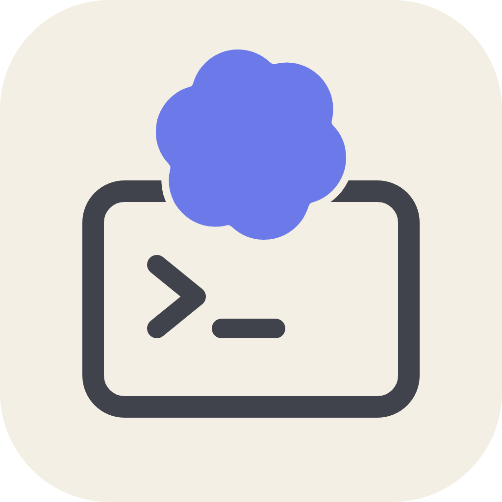
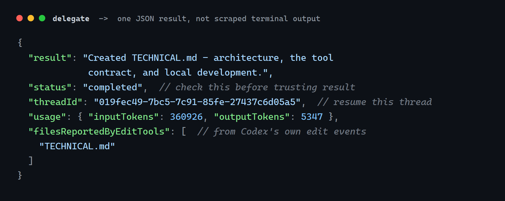

# Codex Delegate

**Ask Codex what it thinks. Or hand it the work.**

[](https://www.npmjs.com/package/codex-delegate-mcp)
[](https://www.npmjs.com/package/codex-delegate-mcp)
[](https://registry.modelcontextprotocol.io/v0.1/servers?search=codex-delegate&version=latest)
[](https://glama.ai/mcp/servers/andreilungeanu/codex-delegate-mcp)
[](https://nodejs.org)
[](LICENSE)
[](https://github.com/andreilungeanu/codex-delegate-mcp/actions/workflows/test.yml)



Codex Delegate is the MCP bridge to the **OpenAI Codex CLI**. From Claude Code, Cursor, Copilot or any MCP client, your agent can ask Codex for a second opinion, put one question to several models at once, or hand Codex a plan, a fix or a review, and get a structured result back from each call.

<br clear="left">

![A terminal recording of Claude Code delegating to Codex: a health check confirms the Codex CLI, auth and model catalog; an ask-mode run diagnoses why the demo repo prints "today 0", naming commitDay() bucketing by UTC while cellDay() labels by local time, with line numbers; one sentence then fans out to two Codex models at once — one editing the repo, one researching in a separate directory — and the fix lands with tests passing and the footer reading today 4, current streak 23, longest streak 23; finally Codex reviews its own diff and reports three findings](assets/demo.gif)

## 🧠 Get a second opinion

> Ask Codex what it thinks about moving the session store to SQLite.

Codex reads the repo and answers in `ask` mode, and your agent sets that answer beside its own. You see where the two disagree before you choose a direction.

Ask several at once, and your agent sends each the same brief in parallel, compares the answers, and checks the claims that matter:

> Ask gpt-6.2-sol and gpt-6-luna whether we should split this service, and tell me where they disagree.

With [Cursor Delegate](https://github.com/andreilungeanu/cursor-delegate-mcp) or [Antigravity Delegate](https://github.com/andreilungeanu/agy-delegate-mcp) installed too, the same prompt reaches Grok, Composer or Gemini.

## 🛠️ Hand off the work

> Use Codex to migrate src/api from callbacks to async/await and update the tests. Plan it first.

Your agent writes the brief, Codex edits the files, and your agent reads the diff and runs the tests before it reports back.

- 📋 **Plan, approve, build** — `plan` returns schema-validated steps; once you approve, the same thread implements them.
- 🔎 **Native review** — `review` runs Codex's own reviewer over uncommitted work, a base branch, or a single commit.
- 🧵 **Resume** — follow up on the same thread with `resumeThreadId`. `resumed: false` tells you the context did not carry over.


## Features

- 📦 **One result you can review** — a compact JSON block: the final answer, `status`, the files Codex's edit tools reported changing, cumulative thread token counts, and the `threadId` to continue from. Fields that carry no signal are omitted.
- ⏳ **Runs in the background in Claude Code** — in the main session of the interactive Claude Code CLI, `delegate` runs as an MCP task: you keep working, and the result arrives as a task notification. Calls from subagents wait for the result.
- 🧑‍🤝‍🧑 **Run several, cancel cleanly** — the same question across models, or independent workers on independent directories. `cancel` waits for the exit and warns when it cannot confirm one.
- 🔋 **Runs on Codex's own account** — delegated work uses whatever the Codex CLI is signed in with, plan or API key, separate from your host's chat quota.
- 🤝 **One-command install** — Claude Code, Google Antigravity, GitHub Copilot CLI, Cursor and VS Code take it as a plugin, with a skill that teaches your agent to write the brief and review the result. JetBrains, Devin Desktop (Windsurf), Visual Studio and the rest add the stdio server in settings.
- 🩺 **`doctor`** — tells you exactly what's missing if setup isn't right.



## The Delegate family

Each plugin works on its own. Install the ones your subscriptions cover, and your agent can ask them the same question in one turn.

| Plugin | Brings in | Stands out for |
| --- | --- | --- |
| **Codex Delegate** (this one) | OpenAI Codex CLI · GPT models | native code review, schema-validated plans |
| [Cursor Delegate](https://github.com/andreilungeanu/cursor-delegate-mcp) | Cursor CLI · Composer, Grok | plan then build in one session, todo progress, image attachments |
| [Antigravity Delegate](https://github.com/andreilungeanu/agy-delegate-mcp) | Antigravity CLI · Gemini | steering a running turn, structured questions, plan artifacts |

## Install

You need [Node.js 20+](https://nodejs.org/) and the [OpenAI Codex CLI](https://github.com/openai/codex), already logged in (`codex login`).

### Claude Code

```shell
/plugin marketplace add andreilungeanu/codex-delegate-mcp
/plugin install codex-delegate@codex-delegate-mcp
```

Then just ask:

> Delegate to Codex: migrate src/api from callbacks to async/await and update the tests, then walk me through what changed.

That's the whole loop — Claude writes the brief, Codex grinds through the files, Claude walks you through the diff.

### Cursor

[](https://cursor.com/en/install-mcp?name=codex-delegate&config=eyJjb21tYW5kIjoibnB4IiwiYXJncyI6WyIteSIsImNvZGV4LWRlbGVnYXRlLW1jcCJdfQ%3D%3D)

Or add it under **Customize → MCPs** in the sidebar, or in `~/.cursor/mcp.json` (every project) or `.cursor/mcp.json` (this project):

```json
{
  "mcpServers": {
    "codex-delegate": {
      "command": "npx",
      "args": ["-y", "codex-delegate-mcp"]
    }
  }
}
```

Then ask Cursor to delegate implementation to Codex the same way.

### Google Antigravity

```shell
agy plugin install https://github.com/andreilungeanu/codex-delegate-mcp
```

Restart the Antigravity app to load it. If you added `codex-delegate` to `mcp_config.json` by hand, remove that entry.

Without the CLI, use the manual config under [More clients](#more-clients).

### GitHub Copilot CLI

```shell
copilot plugin marketplace add andreilungeanu/codex-delegate-mcp
copilot plugin install codex-delegate@codex-delegate-mcp
```

The server alone, without the skill: `copilot mcp add codex-delegate -- npx -y codex-delegate-mcp`.

### More clients

<details>
<summary><strong>VS Code</strong> — one-click install, or <code>.vscode/mcp.json</code></summary>

[](https://vscode.dev/redirect/mcp/install?name=codex-delegate&config=%7B%22type%22%3A%22stdio%22%2C%22command%22%3A%22npx%22%2C%22args%22%3A%5B%22-y%22%2C%22codex-delegate-mcp%22%5D%7D)
[](https://insiders.vscode.dev/redirect/mcp/install?name=codex-delegate&config=%7B%22type%22%3A%22stdio%22%2C%22command%22%3A%22npx%22%2C%22args%22%3A%5B%22-y%22%2C%22codex-delegate-mcp%22%5D%7D&quality=insiders)

```json
{
  "servers": {
    "codex-delegate": {
      "type": "stdio",
      "command": "npx",
      "args": ["-y", "codex-delegate-mcp"]
    }
  }
}
```

Or run **Chat: Install Plugin From Source** with this repository's URL (needs the `chat.plugins.enabled` setting).

</details>

<details>
<summary><strong>JetBrains AI Assistant</strong> — Settings → Tools → AI Assistant → MCP</summary>

Under **Settings → Tools → AI Assistant → Model Context Protocol (MCP)**, click **Add** and paste this JSON:

```json
{
  "mcpServers": {
    "codex-delegate": {
      "command": "npx",
      "args": ["-y", "codex-delegate-mcp"]
    }
  }
}
```

</details>

<details>
<summary><strong>Devin Desktop (formerly Windsurf)</strong> — <code>~/.config/devin/mcp_config.json</code></summary>

This config is for Devin Local, the default agent (Local 3.6+). On Windows the file is `%APPDATA%\devin\mcp_config.json`. Legacy Cascade and older Windsurf builds read `~/.codeium/windsurf/mcp_config.json`.

```json
{
  "mcpServers": {
    "codex-delegate": {
      "command": "npx",
      "args": ["-y", "codex-delegate-mcp"]
    }
  }
}
```

Heads-up: Devin Desktop's Cascade agent caps you at 100 tools across all servers.

</details>

<details>
<summary><strong>Visual Studio 2026 / 2022</strong> — <code>%USERPROFILE%\.mcp.json</code></summary>

```json
{
  "servers": {
    "codex-delegate": {
      "type": "stdio",
      "command": "npx",
      "args": ["-y", "codex-delegate-mcp"]
    }
  }
}
```

Visual Studio 2022 needs 17.14+. Note the top-level key is `servers`, not `mcpServers`. A `.mcp.json` in the solution directory scopes it to that solution.

</details>

<details>
<summary><strong>OpenCode</strong> — <code>~/.config/opencode/opencode.json</code> or project <code>opencode.json</code></summary>

OpenCode does **not** use `mcpServers`. Local servers go under `mcp`, with `type: "local"` and `command` as one array:

```json
{
  "$schema": "https://opencode.ai/config.json",
  "mcp": {
    "codex-delegate": {
      "type": "local",
      "command": ["npx", "-y", "codex-delegate-mcp"],
      "enabled": true
    }
  }
}
```

This is the v1 shape, which OpenCode v2 still reads (v2's native form is `mcp.servers`).

</details>

<details>
<summary><strong>Google Antigravity</strong> (without the plugin) — <code>~/.gemini/config/mcp_config.json</code> or workspace <code>.agents/mcp_config.json</code></summary>

```json
{
  "mcpServers": {
    "codex-delegate": {
      "command": "npx",
      "args": ["-y", "codex-delegate-mcp"],
      "timeoutSeconds": 21660
    }
  }
}
```

</details>

<details>
<summary><strong>Kilo Code</strong> — <code>kilo.jsonc</code> (<code>mcp</code> key, not <code>mcpServers</code>)</summary>

Same shape as OpenCode: `type: "local"` and `command` as one array.

```json
{
  "mcp": {
    "codex-delegate": {
      "type": "local",
      "command": ["npx", "-y", "codex-delegate-mcp"],
      "enabled": true
    }
  }
}
```

In the VS Code extension: **Settings → MCP → Add Server → Local (stdio)**. On Windows, if `npx` is not found, use command `cmd` with arguments `/c`, `npx`, `-y`, `codex-delegate-mcp`.

</details>

### Kiro and any other MCP client

Add the following server to the client's MCP config — for Kiro, `~/.kiro/settings/mcp.json` (user) or `.kiro/settings/mcp.json` (workspace):

```json
{
  "mcpServers": {
    "codex-delegate": {
      "command": "npx",
      "args": ["-y", "codex-delegate-mcp"]
    }
  }
}
```

MIT © [Andrei Lungeanu](https://github.com/andreilungeanu)

<sub>[Configuration](CONFIGURATION.md) · [Security](SECURITY.md) · [Privacy](PRIVACY.md) · [Terms](TERMS.md) · [Changelog](CHANGELOG.md)</sub>
